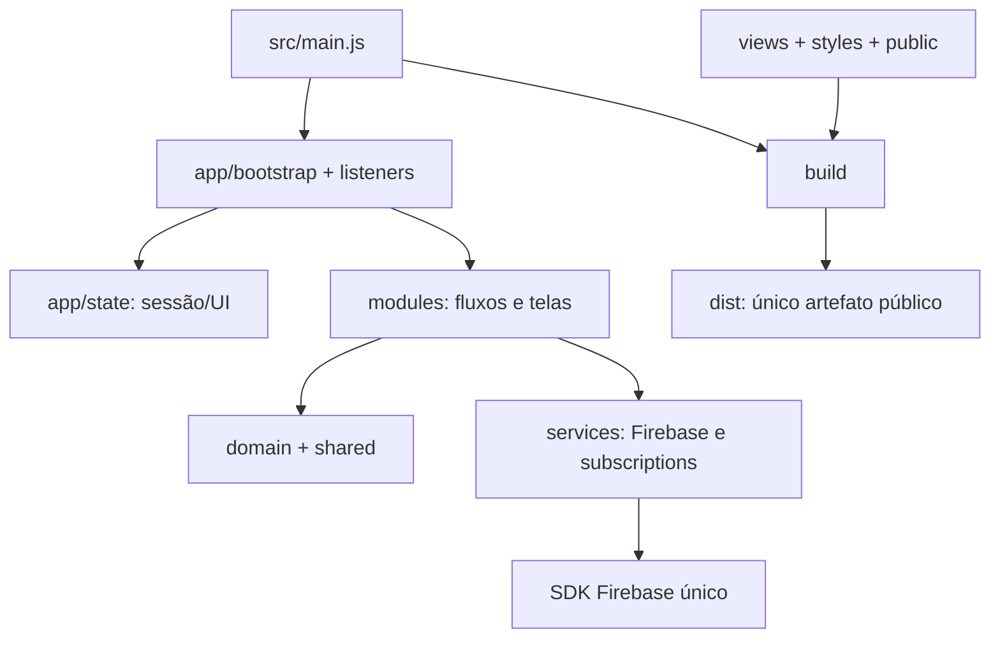

# Mapa atual do repositório — proposta v0.17.0

Base preservada: v0.16.0, commit 113d629c4565a631bd89a5af4c24c3bf40e26a46. A reorganização foi solicitada explicitamente pelo usuário, substituindo o adiamento anterior da extração. Ainda não está publicada.

## Estrutura e dependências

O estado antes implícito no escopo de um script passou a um objeto transitório explícito. Módulos usam imports/exports reais. Existem dependências entre fluxos; a separação não afirma independência total nem substitui autorização/transações do servidor. Agenda e CSV possuem funções reutilizáveis sem navegador. As integrações Firebase ficam centralizadas, com uma única instância de SDK por build.

Formulários genéricos foram divididos em criação, detalhes, campos, salvamento e exclusão. Listeners foram separados de renderização e inicialização. Templates e CSS próprios não contêm lógica de negócio. O build preserva IDs e gera apenas arquivos públicos locais; código de teste, deploy, backups, regras e exportações não entram no pacote do site.

## Limpeza executada

- Retirada do HTML antigo v0.40 e seu README da árvore ativa; recuperação garantida por referência Git/bundle, sem reescrever histórico.
- URL antiga preservada como orientação estática sem Firebase, sem reativar os fluxos antigos.
- Prévia de perfis movida para public, mantendo sua URL no artefato.
- Remoção do empacotamento duplicado e das substituições por regex da homologação; produção e demo usam o mesmo build e modo explícito.
- Ferramentas de build/navegador passaram a dependências fixadas do projeto, sem depender de diretório de ferramentas externo.
- Importações não usadas removidas durante a extração; fonte formatada por responsabilidade.
- README/CONTRIBUTING atualizados; mapa anterior preservado em historico/mapa-organizacao-2026-10-20.md.
- Saídas, backups, exportações e .env ignorados; publicação por lista controlada a partir de dist.

Demandas, Apoio, Locais, regras, índices, testes e lockfile permanecem necessários. Não foram apagados por estarem fora da prioridade de Eventos. [Auditoria de legado](auditoria-legado.md).

## Preservação e migração

Nenhuma operação de negócio foi feita no Firebase real. O build de desenvolvimento força o projeto demo e emuladores. O SDK Firebase foi atualizado na linha compatível com Node 22, e a CLI/ferramentas também foram atualizadas após auditoria de dependências; as versões exatas estão no lockfile e as validações finais no relatório de testes.

Branches e tags remotas foram inventariadas e preservadas; nomes antigos não foram tratados como prova de irrelevância. Havia 21 referências remotas integradas e quatro alternativas com diferenças fora da main no inventário local, além da branch desta proposta. O bundle externo inclui todas as referências disponíveis antes da limpeza. Isso não é backup dos bancos/Auth.

A VM pode servir dist com os templates Nginx preparados. PostgreSQL recebe somente staging de ensaio e ferramenta offline; identidade institucional tem contrato explícito para OIDC/LDAPS no servidor. A API, esquema de negócio, carga final e provedor reais ainda dependem de implementação e aprovação. Ver [migração](migracao/README.md).
